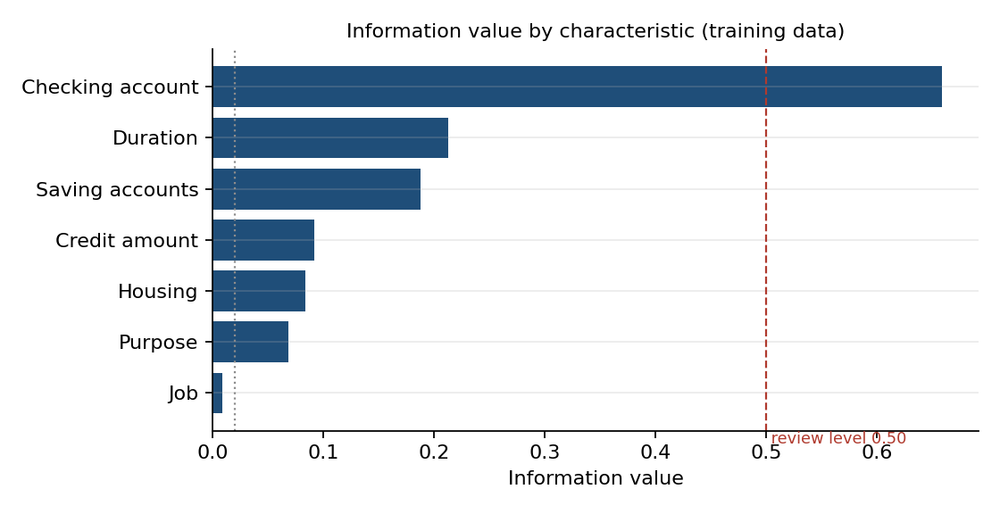
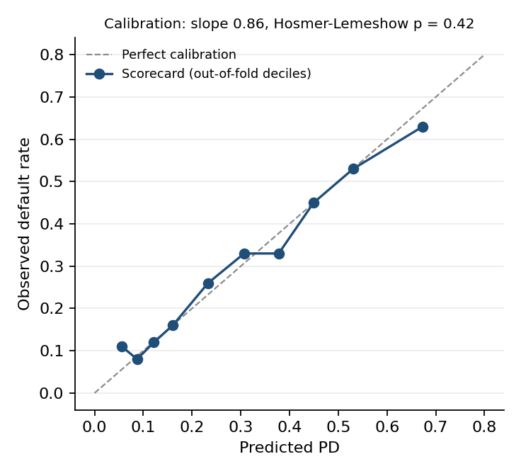
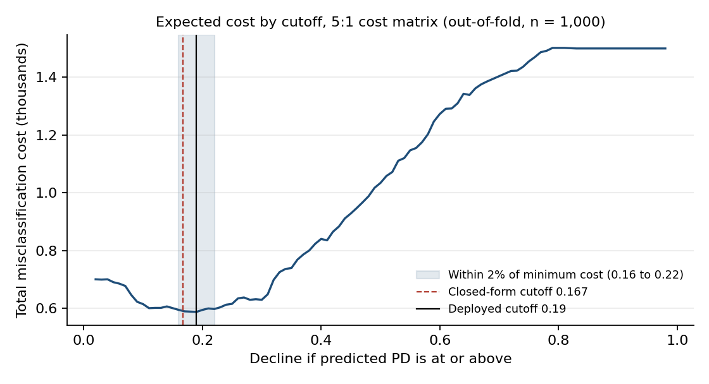

# Credit Risk Modeling


A retail **probability-of-default (PD) model**: a Weight-of-Evidence scorecard benchmarked against a monotone-constrained XGBoost challenger, with cost-optimised decision cutoffs, scenario stress testing, per-applicant SHAP reason codes, a fairness audit and an independent-style validation memo. Served through a Streamlit app.

> Demonstration project on public data. Not for real lending decisions.

**Contents:** [At a glance](#at-a-glance) · [Quickstart](#quickstart) · [Data and target](#data-and-target) · [Methodology](#methodology) · [Results](#results) · [Streamlit app](#streamlit-app) · [Validation](#validation) · [Limitations](#limitations) · [Repository structure](#repository-structure) · [Testing and reproducibility](#testing-and-reproducibility) · [Roadmap](#roadmap)

---

## At a glance

| | WoE scorecard (champion) | XGBoost (challenger) |
|---|---|---|
| Gini, out-of-fold (n = 750) | 0.493 (95% CI 0.420 to 0.564) | 0.517 (0.444 to 0.590) |
| Gini, holdout (n = 250) | 0.514 (0.375 to 0.640) | 0.475 (0.330 to 0.599) |
| KS, holdout | 0.453 | 0.394 |
| Brier score, holdout | 0.173 | 0.181 |
| Calibration (Hosmer-Lemeshow p) | 0.425 (pass) | 0.002 (fail) |
| Deployed decline cutoff (PD) | 0.19 | 0.20 |

- **The challenger adds nothing measurable.** The paired-bootstrap Gini difference (XGBoost minus scorecard) is -0.001 with a 95% CI of -0.018 to +0.014, and XGBoost fails calibration. The transparent scorecard is the champion.
- **The decision cutoff is derived, not guessed.** A 5:1 cost matrix (approving a defaulter costs 5, rejecting a good borrower costs 1) gives a closed-form Bayes cutoff of 0.167. The empirical optimum agrees. On the holdout, the cost-optimal cutoff cuts expected cost per applicant from 1.03 (0.50 cutoff) to 0.55.
- **Leakage is controlled and measured.** WoE is fitted inside each cross-validation fold. Fitting it on the full sample first inflates out-of-fold Gini by 0.041 (scorecard).
- **Independent-style validation.** [`VALIDATION_MEMO.md`](VALIDATION_MEMO.md) rates the model *Satisfactory with Conditions, restricted to demonstration use*, with 8 findings (2 High, 4 Medium, 2 Low).

---

## Quickstart

Requires Python 3.10 or later (developed on 3.12).

```bash
git clone https://github.com/Jazmin00911/CreditRiskModeling.git
cd CreditRiskModeling
python -m venv .venv && source .venv/bin/activate     # Windows: .venv\Scripts\activate
pip install -r requirements.txt
pip install -e .

python -m creditrisk.train        # fits both models; writes artifacts/ and reports/
python -m creditrisk.validate     # regenerates every figure quoted in the validation memo
python -m creditrisk.figures      # rebuilds docs/figures/*.png
streamlit run app/streamlit_app.py
pytest -q
```

Model files are generated locally and are not committed. If none exist, the app trains both models on first launch (about 25 seconds on a laptop) and keeps them in a temporary directory. Running `creditrisk.train` first only skips that wait.

---

## Data and target

- **Source:** public German Credit dataset, as committed in `data/raw/` (n = 1,000; 30.0% default). The file is a reduced, relabelled distribution, and the relabelling is undocumented. No origination dates exist.
- **Target:** `Risk == "bad"` is the default event (y = 1). Every metric, sign and cost in the repository follows this convention.
- **Model inputs (7):** Job, Credit amount, Duration, Housing, Saving accounts, Checking account, Purpose.
- **Audit-only attributes:** Sex and Age are excluded from the model and used only in the fairness audit. Dropping Age leaves Gini unchanged (0.493 to 0.496).
- **Missing values are a category, not noise.** The raw file stores "no account" as the string `NA`, which pandas converts to `NaN`. 183 savings and 394 checking values are affected (478 rows have at least one). Complete-case deletion would discard 47.8% of applicants and move the default rate from 30.0% to 44.3%, because the deleted rows default at only 14.4%. They are retained as an explicit `none` level.

---

## Methodology

**1. Feature engineering: WoE and IV.** Each characteristic is binned (five equal-frequency bins for high-cardinality numerics) and mapped to WoE = ln(%good / %bad), with additive smoothing of 0.5. Higher WoE means lower risk. Information value, IV = Σ (%good − %bad) × WoE, ranks characteristics. Unseen categories receive a neutral WoE of 0.

**2. Models.** The champion is an L2-penalised logistic regression on WoE inputs, convertible to a points scorecard (`reports/scorecard_points.csv`). The challenger is XGBoost (depth 2, 200 trees) with a -1 monotone constraint on every WoE input, which is valid by construction because WoE is monotone in risk. No class re-weighting is applied: re-weighting moves mean PD from 0.301 to 0.449 against a 0.300 observed rate with no gain in rank ordering.

**3. Validation protocol.** Out-of-fold cross-validation supports model selection and cutoff choice, and the holdout is scored once. Confidence intervals use a percentile bootstrap. A repeated 5×5-fold run on all 1,000 rows gives a Gini of 0.496 (scorecard) and 0.491 (XGBoost). A walk-forward backtest with a label-maturity gap is implemented and unit-tested on a synthetic panel; it needs a dated dataset to run on real vintages.

**4. Decision cutoff.** The cutoff minimises expected cost under the cost matrix. With calibrated PDs the optimum is `c_FP / (c_FP + c_FN)` = 0.167. The cost curve is flat near its minimum, so the cutoff is reported as a range (0.16 to 0.22) and not as a single point.

**5. Stress overlay.** A Vasicek single-factor probit shift treats the model PD as the PD at the median state of the economy, so z = 0 returns the PD unchanged. Under illustrative macro loadings, portfolio expected loss rises to 1.45× (adverse) and 1.88× (severely adverse). Loadings, asset correlation (0.10) and LGD (0.45) are assumptions, not estimates.

**6. Explainability.** SHAP values are computed in log-odds of default, per applicant. Because each model input is one WoE column per raw variable, every contribution maps to one field the applicant entered. The top factors pushing toward decline become reason codes.

**7. Fairness audit.** Approval rates, error rates and adverse-impact ratios are reported by sex and age band at the deployed cutoff (`reports/fairness_*.csv`).

---

## Results

| Information value by characteristic | Calibration (out-of-fold deciles) |
|---|---|
|  |  |



| Characteristic | IV | Reading |
|---|---|---|
| Checking account | 0.659 | Above the 0.50 review level. Driven by applicants with no checking account (11.7% default). Removing it lowers Gini by 0.155 |
| Duration | 0.213 | Medium |
| Saving accounts | 0.188 | Medium |
| Credit amount, Housing, Purpose | 0.092, 0.084, 0.068 | Weak |
| Job | 0.009 | Below the noise floor; contributes no out-of-sample discrimination |

---

## Streamlit app

`streamlit run app/streamlit_app.py` opens a decision-support interface with a model selector (scorecard or XGBoost) and the decline cutoff in the sidebar. For each applicant it returns:

- **Decision:** PD, distance from the cutoff, approve or decline, and principal reasons for a decline.
- **Why this decision:** SHAP waterfall of each factor's contribution in log-odds.
- **Stress test:** PD and decision under the baseline, adverse and severely adverse scenarios.
- **Model card:** training size, default rate, holdout metrics and library versions.

All input choices and ranges are generated from the training data, so the interface cannot offer a level the model has never seen.

<!-- After deploying, uncomment and set your link: **Live demo:** [Open the app](https://YOUR-APP.streamlit.app) -->

**Deployment (Streamlit Community Cloud).** Push the repository to GitHub (public), create an app at share.streamlit.io, set the main file to `app/streamlit_app.py`, and deploy. Dependencies come from `requirements.txt`, which pins Streamlit. The first load trains the models, and free-tier apps sleep after 12 hours without traffic, so the first visit after a quiet period shows a wake-up page.

---

## Validation

[`VALIDATION_MEMO.md`](VALIDATION_MEMO.md) applies a second-line validation framework (SR 11-7 structure) to this model. Every figure in it is regenerated by `python -m creditrisk.validate` into `reports/validation_results.json`.

| Severity | Findings |
|---|---|
| High (2) | Evidence base cannot support production reliance (n = 1,000, no time dimension); dominant driver without an economic rationale |
| Medium (4) | Cutoff instability and an unvalidated cost assumption; disparate outcomes for applicants under 30; wrong-sign and sparse characteristics; assumed stress parameters |
| Low (2) | Monitoring design (PSI misses shifts that CSI catches); input-domain and artifact-integrity controls |

The memo states its own independence limitation: the validator and the developer are the same person, so it is an exercise in applying the framework and carries no approval authority.

---

## Limitations

- **Small sample, no dates.** Holdout Gini confidence intervals span about 0.27, and out-of-time validation cannot be run on real vintages.
- **Dominant driver.** "No checking account" is the lowest-risk group in this dataset, which is counterintuitive and has no documented rationale.
- **Cost matrix.** The 5:1 ratio is an assumption borrowed from the German Credit documentation. At this ratio the deployed cutoff declines about 60% of applicants.
- **Fairness.** Applicants under 30 have an adverse-impact ratio of 0.68 against a 0.80 screen even with Age excluded. It is documented, not resolved. The sex ratio is 0.91.
- **Stress parameters.** Macro loadings, asset correlation and LGD are stated assumptions.
- **Explanations.** SHAP explains the model, not causal effects.

---

## Repository structure

```
src/creditrisk/     config, data, woe, model, validation, threshold, stress,
                    explain, metrics, train, validate, figures
app/                streamlit_app.py (interface only; no modelling logic)
tests/              WoE known-answer, PSI, bootstrap, closed-form cutoff, stress,
                    SHAP additivity, bundle round-trip, walk-forward
reports/            generated: metrics, IV table, scorecard points, cost curves,
                    fairness, stress, validation results
docs/figures/       generated charts used in this README
notebooks/          01_eda_and_baseline.ipynb (exploratory analysis)
data/raw/           source CSV
VALIDATION_MEMO.md  independent-style validation memo
.github/workflows/  CI: ruff, mypy, pytest, training run
```

---

## Testing and reproducibility

- **14 tests** cover the WoE transform against a hand-computed case, PSI, bootstrap intervals, the closed-form cutoff on calibrated synthetic data, stress identity and monotonicity, SHAP additivity for both models, artifact round-trip, walk-forward logic and a cold-start smoke test of the Streamlit app.
- **CI** runs `ruff`, `mypy` and `pytest` on every push, then retrains to confirm the pipeline runs end to end.
- **Seeds are fixed.** Reported figures come from Python 3.12.3, scikit-learn 1.8.0, XGBoost 3.4.1, pandas 3.0.2, NumPy 2.4.4, SciPy 1.17.1 and Streamlit 1.66.1. Other versions can shift results in the third decimal, most likely for XGBoost.

---

## Roadmap

Planned, not yet built:

1. Re-run validation on a dated portfolio (walk-forward by vintage, real PSI and CSI drift).
2. Replace the flat cost matrix with exposure-weighted LGD × EAD against lifetime margin.
3. Estimate stress loadings from dated default and macroeconomic series.
4. Implement the monitoring job specified in the validation memo.
5. Extend PD to an IFRS 9-style expected-credit-loss engine (staging, lifetime PD, scenario weighting).

---

## Data source and disclaimer

The German Credit dataset originates from Prof. Dr. Hans Hofmann (University of Hamburg) and is distributed publicly through the UCI Machine Learning Repository. This project is for education and portfolio purposes. Outputs are illustrative and must not be used for credit decisions.

